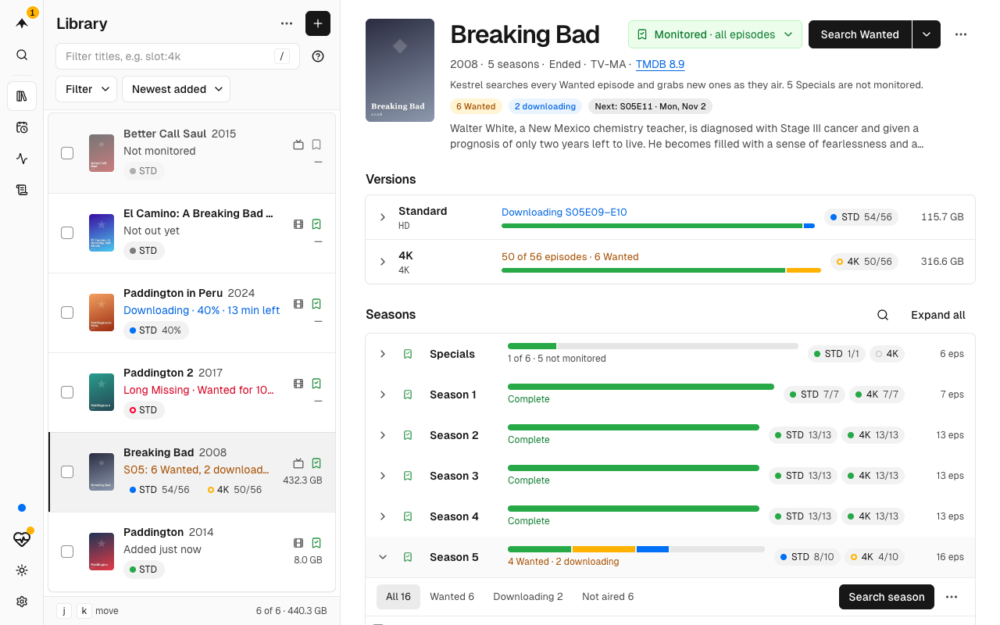

<p align="center">
  <picture>
    <source media="(prefers-color-scheme: dark)" srcset="docs/guide/images/logo-dark.svg">
    
  </picture>
</p>

<h1 align="center">Kestrel</h1>

<p align="center">One app that finds, downloads and files your movies and series, in place of Radarr and Sonarr.</p>

Kestrel is usenet only, and SABnzbd is the one download client it supports today.

<picture>
  <source media="(prefers-color-scheme: dark)" srcset="docs/guide/images/04-series-dark.png">
  
</picture>

[](https://github.com/hyprsh/kestrel/releases/latest)
[](https://github.com/hyprsh/kestrel/pkgs/container/kestrel)
[](https://github.com/hyprsh/kestrel/actions/workflows/ci.yml)
[](LICENSE)

## Why Kestrel

- **One app for movies and series.** No second install for TV.
- **Standard and 4K side by side, or Slots of your own.** A Title can keep up to four Versions, such as 1080p and 4K, a Remux, or a dub next to the Original Language. Each is filled and upgraded on its own.
- **TRaSH Guides scoring, built in.** Kestrel scores every Release with [TRaSH Guides](https://trash-guides.info)' Custom Formats and keeps them up to date. You pick a Profile instead of tuning numbers.
- **Releases in your language.** Choose English, German or French once. Kestrel wants that audio, and falls back to the original language when you allow it.
- **Upcoming.** A timeline of what airs and releases next, and where each item stands.
- **Requests.** People who share your Plex server, and Silo users, can ask for a Title themselves, without a separate request app.
- **Jellyfin and Plex refresh.** New files show up in your media server as soon as they are imported.
- **Moving in is easy.** Kestrel can take in the library Radarr and Sonarr built, so it doesn't download it again.

Kestrel ships as one Docker image that holds a single Go binary with the web UI inside.

## Quick start

You need Docker with Compose, a usenet provider and an account at a Newznab indexer.

Create the folders first, on one disk or pool. Both containers see them as the same `/data`, so Imports can hardlink. This is the [TRaSH](https://trash-guides.info/File-and-Folder-Structure/) layout:

```sh
sudo mkdir -p /srv/data/usenet/incomplete /srv/data/usenet/complete/movies /srv/data/usenet/complete/tv /srv/data/media/movies /srv/data/media/tv
sudo chown -R 1000:1000 /srv/data
```

Then save this as `compose.yaml`:

```yaml compose.yaml
services:
  kestrel:
    image: ghcr.io/hyprsh/kestrel:latest
    container_name: kestrel
    environment:
      - PUID=1000
      - PGID=1000
      - UMASK=002
      - TZ=Europe/Berlin
    volumes:
      - ./kestrel:/config # SQLite database, migration backups, poster cache
      - /srv/data:/data # media library and downloads
    ports:
      - 7676:7676
    restart: unless-stopped

  sabnzbd:
    image: lscr.io/linuxserver/sabnzbd:latest
    container_name: sabnzbd
    hostname: sabnzbd # lets Kestrel reach SABnzbd by this name on its first start
    environment:
      - PUID=1000
      - PGID=1000
      - UMASK=002
      - TZ=Europe/Berlin
    volumes:
      - ./sabnzbd:/config
      - /srv/data:/data
    ports:
      - 8080:8080
    restart: unless-stopped
```

Then:

1. Run `docker compose up -d`.
2. Set up SABnzbd at <http://localhost:8080>: your usenet provider, the Temporary Download Folder `/data/usenet/incomplete`, the Completed Download Folder `/data/usenet/complete`, and the categories `movies` and `tv`.
3. Open <http://localhost:7676> and walk through the setup screen: create the admin account, choose your language, connect SABnzbd (`http://sabnzbd:8080` and its API key), add a Newznab indexer, check the root folders, and choose a Slot preset. **One copy** is the simple choice, and you can change it later.
4. Choose **+** in the Library (or press <kbd>Ctrl</kbd> <kbd>K</kbd>), search for a movie or series, and add it. Kestrel searches, downloads and imports it.

[Getting started](https://hyprsh.github.io/kestrel/guide/getting-started) does each step with screenshots.

## Learn more

The docs are at **<https://hyprsh.github.io/kestrel/>**.

- [Getting started](https://hyprsh.github.io/kestrel/guide/getting-started): the first run, screen by screen.
- [Customizing](https://hyprsh.github.io/kestrel/guide/customizing): what you can change, from Versions and quality to folders, indexers and Requests, and where.
- [Concepts](https://hyprsh.github.io/kestrel/guide/concepts): Title, Slot, Version, Profile and the other words, in plain language.
- [Slots](https://hyprsh.github.io/kestrel/guide/slots): the copies a Title keeps, and how to define your own.
- [Moving from Radarr and Sonarr](https://hyprsh.github.io/kestrel/guide/moving-from-radarr-and-sonarr): adopt your library, and what maps to what.
- [Configuration](https://hyprsh.github.io/kestrel/guide/configuration): environment variables, the Config File and Requesters.
- [Troubleshooting](https://hyprsh.github.io/kestrel/guide/troubleshooting): connecting SABnzbd, hardlinks, permissions, indexer limits, a forgotten password, and where the logs are.
- [API](https://hyprsh.github.io/kestrel/guide/api): the REST API, defined by [`api/openapi.yaml`](api/openapi.yaml). A running Kestrel serves interactive docs at `/api/docs`.
- [Contributing](https://hyprsh.github.io/kestrel/development/contributing): build it, change it, release it.
- [Security](SECURITY.md): how to report a vulnerability.

The words Kestrel uses are in the [glossary](https://hyprsh.github.io/kestrel/glossary).

## Licence

GPL-3.0-only. See [`LICENSE`](LICENSE).
