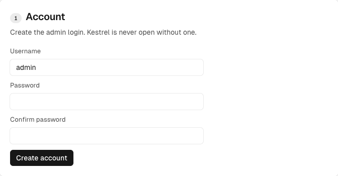
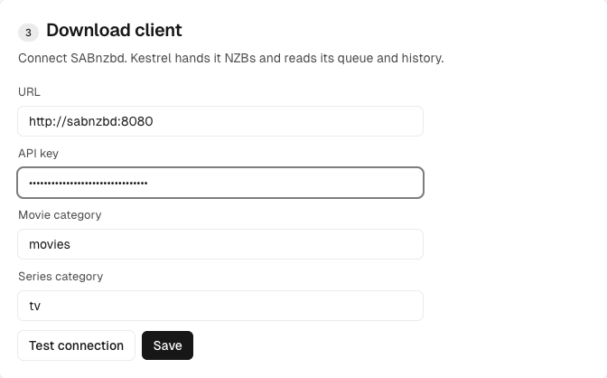
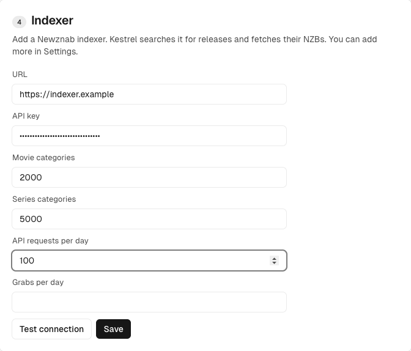
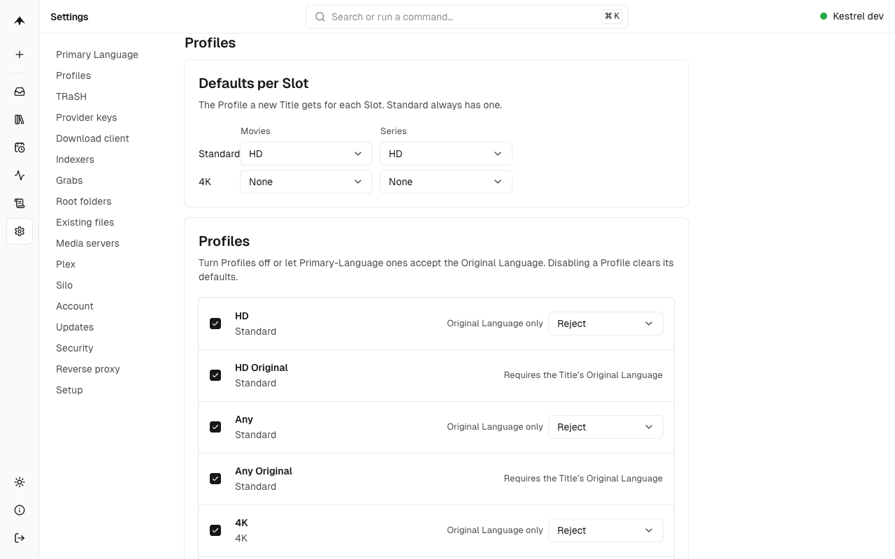
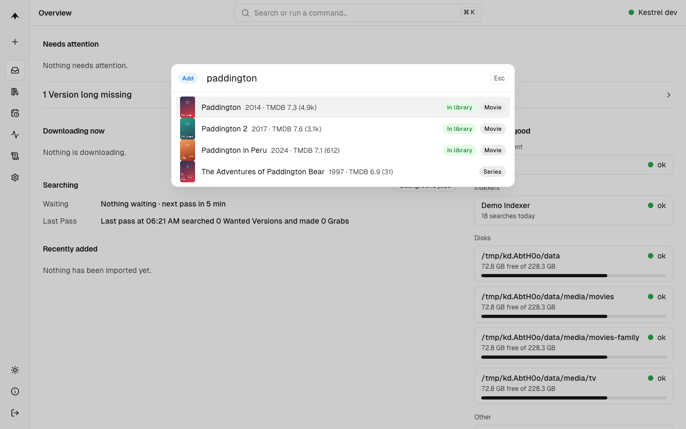
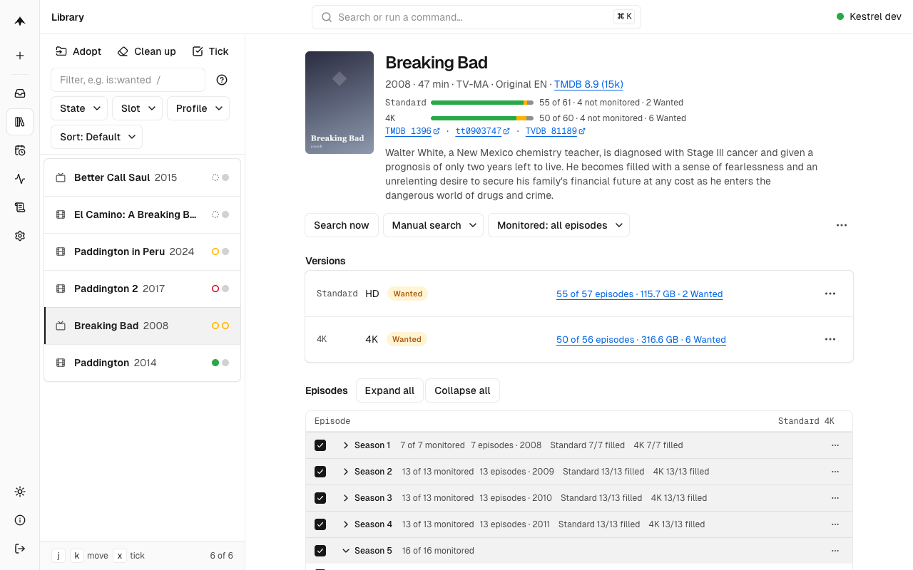
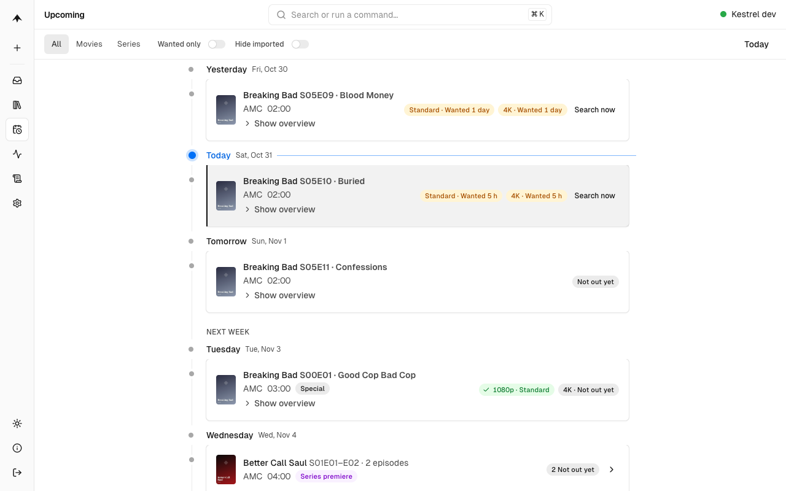

# Getting started

This guide takes you from nothing to your first download. It takes about fifteen minutes. You will:

1. Lay out your storage and start Kestrel and SABnzbd.
2. Set up SABnzbd.
3. Walk through Kestrel's setup screen.
4. Add a Title and watch it arrive.

Kestrel is usenet only, and SABnzbd is the one download client it supports today. You need a usenet provider, a Newznab indexer account and Docker. Never heard of a Title, Slot or Profile? [Concepts](concepts.md) explains them in plain words.

## The /data layout

Kestrel moves a finished download into your library with a **hardlink**: a second name for the same file, so the Import takes no extra space and happens at once. Hardlinks only work inside one filesystem. So downloads and library must be under one mount, and both Kestrel and SABnzbd must see it at the same path. The layout from [TRaSH Guides](https://trash-guides.info/File-and-Folder-Structure/) does this:

```text
/data                      the one folder you mount into every container
├── usenet
│   ├── incomplete         SABnzbd's temporary folder
│   └── complete
│       ├── movies         SABnzbd's "movies" category
│       └── tv             SABnzbd's "tv" category
└── media
    ├── movies             Kestrel's Movies root folder
    └── tv                 Kestrel's Series root folder
```

On the host, `/data` is a folder such as `/srv/data` on one disk or pool. Create the folders once, and give them to the user you'll run the containers as (`1000`, unless you change `PUID` and `PGID`):

```sh
mkdir -p /srv/data/usenet/incomplete /srv/data/usenet/complete/{movies,tv} /srv/data/media/{movies,tv}
chown -R 1000:1000 /srv/data
```

If the two sit on different mounts, Imports still work, but each one copies the file. [Troubleshooting](troubleshooting.md#imports-are-copied-not-hardlinked) shows how to spot and fix it.

## Start Kestrel and SABnzbd

Use the `compose.yaml` from the [README's quick start](../../README.md#quick-start). It runs both containers with the same `/srv/data:/data` mount. Change `TZ` to yours, and `/srv/data` if your folder is elsewhere. Then:

```sh
docker compose up -d
```

Kestrel is at <http://localhost:7676> and SABnzbd at <http://localhost:8080>.

## Set up SABnzbd

Open SABnzbd and its wizard asks for your usenet provider's server details. Enter them. Then, in SABnzbd's Config:

1. **Folders:** set the Temporary Download Folder to `/data/usenet/incomplete` and the Completed Download Folder to `/data/usenet/complete`.
2. **Categories:** add `movies` and `tv`. Leave each one's folder empty, or set it to its own name, so downloads land in `/data/usenet/complete/movies` and `/data/usenet/complete/tv`.
3. **General:** copy the **API Key**. Kestrel needs it in a minute.

Kestrel tells SABnzbd which category to use, and reads back where each download finished. That is why both must see `/data` at the same path.

## Walk through Kestrel's setup

Open <http://localhost:7676>. A fresh Kestrel shows the setup screen, a short list of sections. A section folds to a one-line summary once it is done.

### 1. Account

Choose a username and a password of at least eight characters. Kestrel is never open without a login. This is the admin account.

<picture>
  <source media="(prefers-color-scheme: dark)" srcset="images/01-setup-account-dark.png">
  
</picture>

### 2. Primary Language

Choose the language your household watches in: English, German or French. Kestrel looks for Releases with that audio, falling back to a Title's original language when you allow it. The release-date country decides when a Title counts as released. It follows the language until you edit it.

You can change both later in Settings. Changing the language re-scores the files you already have.

### 3. Download client

Connect SABnzbd:

| Field               | What to enter                                                                                                                            |
| ------------------- | ---------------------------------------------------------------------------------------------------------------------------------------- |
| **URL**             | `http://sabnzbd:8080`. In one compose file, a container reaches another by its service name. If SABnzbd runs elsewhere, use its address. |
| **API key**         | The key you copied from SABnzbd's Config > General.                                                                                      |
| **Movie category**  | `movies`, as you named it in SABnzbd.                                                                                                    |
| **Series category** | `tv`, as you named it in SABnzbd.                                                                                                        |

Choose **Test connection**, then **Save**.

<picture>
  <source media="(prefers-color-scheme: dark)" srcset="images/02-setup-download-client-dark.png">
  
</picture>

### 4. Indexer

An indexer is the site that lists what's on usenet. Kestrel searches it and fetches the NZB files. It speaks Newznab, which almost every usenet indexer does.

| Field                         | What to enter                                                                                                            |
| ----------------------------- | ------------------------------------------------------------------------------------------------------------------------ |
| **URL**                       | Your indexer's address, such as `https://indexer.example`. Your indexer's API or "Newznab" help page shows it.           |
| **API key**                   | From your indexer account's profile or API page.                                                                         |
| **Movie / Series categories** | Leave `2000` and `5000`, the Newznab standard for movies and TV.                                                         |
| **API requests per day**      | Your indexer's daily limit, or a little under it. Kestrel pauses searches to stay below it. Leave it empty for no limit. |
| **Grabs per day**             | The same for downloads, if your indexer limits them.                                                                     |

Choose **Test connection**, then **Save**. You can add more indexers later in Settings > Indexers.

<picture>
  <source media="(prefers-color-scheme: dark)" srcset="images/03-setup-indexer-dark.png">
  
</picture>

### 5. Root folders

The root folders are where Kestrel puts your Movies and your Series. They are prefilled for the layout above: `/data/media/movies` and `/data/media/tv`. Each folder must exist and be writable by Kestrel. Keep them on the same mount as your downloads, or Imports can't hardlink. Add a second folder if you want one for another audience, such as `/data/media/movies-kids`. The first is the default.

### 6. Profiles

A Profile is a quality-and-language target. Here you pick the one each new Title gets per Slot. Standard is preselected (HD, for Movies and Series). Leave 4K at None and add 4K per Title when you want it. You can change all of it later in Settings > Profiles.

<picture>
  <source media="(prefers-color-scheme: dark)" srcset="images/07-profiles-dark.png">
  
</picture>

### 7. Adopt existing library (optional)

If you already have files in those folders, Kestrel can scan them and take them in, so it doesn't download them again. Skip this for now if the library is empty. [Moving from Radarr and Sonarr](moving-from-radarr-and-sonarr.md) covers it in detail.

Choose **Finish setup**. If something is missing, Kestrel names the section. You'll land on the Overview.

## Add your first Title

Choose **+** in the side bar, or press <kbd>⌘</kbd> <kbd>K</kbd> (<kbd>Ctrl</kbd> <kbd>K</kbd> on Windows and Linux; the magnifier in the side bar opens the same menu), and type a name. Pick the right result. Titles you already have say "In library".

<picture>
  <source media="(prefers-color-scheme: dark)" srcset="images/05-add-title-dark.png">
  
</picture>

The next step is the add panel. It is preselected from your defaults, and says why:

- **Slots:** tick Standard, 4K or both. Each ticked Slot gets its own file, under the Profile you pick beside it.
- **Monitor** (Series only): which seasons to want. All of them, only future episodes, only the first or latest season, or a pick.
- **Root folder:** only shown when you have more than one.

Choose **Add**.

## What Kestrel does next

You don't need to do anything else. Kestrel does this on its own:

1. **Searches.** A new Title is searched straight away. After that, Kestrel searches everything that is [Wanted](concepts.md#wanted) every five minutes.
2. **Scores and grabs.** From the Releases the indexer lists, Kestrel picks the best one that fits the Version's Profile and sends it to SABnzbd.
3. **Follows the download.** Activity shows each Grab from Searching to Downloading, with progress. A download that makes no progress is flagged as stuck ([Troubleshooting](troubleshooting.md#a-download-is-stuck)).
4. **Imports.** When SABnzbd is done, Kestrel hardlinks the file into the Title's folder under your root folder and names it by its fixed scheme, such as `Paddington (2014) {tmdb-116149}/Paddington (2014) - [Standard] …`.
5. **Tells your media server.** If you have connected Jellyfin or Plex in Settings > Media servers, Kestrel asks it to refresh.
6. **Keeps upgrading.** If a better Release appears later, Kestrel replaces the file.

<picture>
  <source media="(prefers-color-scheme: dark)" srcset="images/04-series-dark.png">
  
</picture>

The Title page shows each Version and what it still lacks. **Search now** searches straight away, and **Manual search** lists every Release, so you can choose one yourself.

**Upcoming** is the timeline of what is airing or being released, from the last two weeks to the next two months, and where each one stands.

<picture>
  <source media="(prefers-color-scheme: dark)" srcset="images/06-upcoming-dark.png">
  
</picture>

## The Overview and Activity

The **Overview** is the home screen. The **Health** button (a heart-pulse icon with a status dot, in the side bar and on a phone in the top bar) is green when all checks are OK, amber with Warnings and red with Blocking issues; hover it for "Health · 1 Blocking, 2 Warnings". It opens Activity > Health and reads "Offline" when Kestrel can't be reached, and a Blocking issue also puts a banner across every screen. A disk that is running low shows as a Health check and a row in **Happening now**. **Happening now** is one list of what wants a decision (Needs attention, one compact row per item with its poster and buttons, plus an Adoption plan waiting for review, versions that have been missing for a long time and Originals on offer) and what is downloading. Below it, **Recently added**, **Recent requests** and **Coming this week** are three short lists side by side, each with a link to its screen. Press `j` and `k` to move through the rows.

**Activity** has three views, each with its own address. The menu at the start of the top bar (it shows the current view, such as "Grabs") switches between them:

- **Grabs** (`/activity`) shows every Grab from Searching to Done, grouped by stage. Narrow it with the filter field or the Filter button, which lists the stages with how many Grabs each holds.
- **Health** (`/activity/health`) shows every check: the download client, each indexer, each disk and the rest. It counts problems, warnings and OK checks, and the view menu carries a dot beside Health while anything fails or warns.
- **Background Jobs** (`/activity/jobs`) shows what Kestrel is running now and when each periodic job last ran and runs next.

## Where to go next

- Connect Jellyfin or Plex in Settings > Media servers, so new files show up at once.
- Let the people you share Plex with ask for Titles themselves: [Requesters](configuration.md#requesters-plex-sign-in).
- Coming from Radarr and Sonarr? [Moving from Radarr and Sonarr](moving-from-radarr-and-sonarr.md).
- Want the same setup every time? Declare it in a [Config File](configuration.md#the-config-file).
- Something not working? [Troubleshooting](troubleshooting.md).
