# Getting started

This guide takes you from nothing to your first download, in about fifteen minutes. Kestrel is usenet only, and SABnzbd is the one download client it supports today.

**Before you start, you need:**

- Docker with Compose.
- A usenet provider, the service that carries the downloads.
- An account at a Newznab indexer, the site that lists what's on usenet.

**You will:**

1. [Create your folders](#the-data-layout).
2. [Start Kestrel and SABnzbd](#start-kestrel-and-sabnzbd).
3. [Set up SABnzbd](#set-up-sabnzbd).
4. [Walk through Kestrel's setup screen](#walk-through-kestrels-setup).
5. [Add a Title](#add-your-first-title) and watch it arrive.

New words such as Title, Slot and Profile are explained as they come up, and [Concepts](concepts.md) has them all in plain words.

## The /data layout

Kestrel moves a finished download into your library with a **hardlink**: a second name for the same file, so the Import takes no extra space and happens at once. Hardlinks only work inside one filesystem. So downloads and library must be under one mount, and both Kestrel and SABnzbd must see it at the same path. The layout from [TRaSH Guides](https://trash-guides.info/File-and-Folder-Structure/) does this:

```text
/data                      the one folder you mount into every container
├── usenet
│   ├── incomplete         SABnzbd's temporary folder
│   └── complete
│       ├── movies         SABnzbd's "movies" category
│       └── tv             SABnzbd's "tv" category
└── media
    ├── movies             Kestrel's Movies root folder
    └── tv                 Kestrel's Series root folder
```

On the host, `/data` is a folder such as `/srv/data` on one disk or pool. Create the folders once, and give them to the user you'll run the containers as (`1000`, unless you change `PUID` and `PGID`). Kestrel never changes who owns `/data`, so skip this and it can't write there.

```sh
sudo mkdir -p /srv/data/usenet/incomplete /srv/data/usenet/complete/movies /srv/data/usenet/complete/tv /srv/data/media/movies /srv/data/media/tv
sudo chown -R 1000:1000 /srv/data
```

If the two sit on different mounts, Imports still work, but each one copies the file. [Troubleshooting](troubleshooting.md#imports-are-copied-not-hardlinked) shows how to spot and fix it.

## Start Kestrel and SABnzbd

Save this as `compose.yaml`. Change `TZ` to yours, and `/srv/data` if your folder is elsewhere.

```yaml compose.yaml
services:
  kestrel:
    image: ghcr.io/hyprsh/kestrel:latest
    container_name: kestrel
    environment:
      - PUID=1000
      - PGID=1000
      - UMASK=002
      - TZ=Europe/Berlin
    volumes:
      - ./kestrel:/config # SQLite database, migration backups, poster cache
      - /srv/data:/data # media library and downloads
    ports:
      - 7676:7676
    restart: unless-stopped

  sabnzbd:
    image: lscr.io/linuxserver/sabnzbd:latest
    container_name: sabnzbd
    hostname: sabnzbd # lets Kestrel reach SABnzbd by this name on its first start
    environment:
      - PUID=1000
      - PGID=1000
      - UMASK=002
      - TZ=Europe/Berlin
    volumes:
      - ./sabnzbd:/config
      - /srv/data:/data
    ports:
      - 8080:8080
    restart: unless-stopped
```

Then start both:

```sh
docker compose up -d
```

Kestrel is at <http://localhost:7676> and SABnzbd at <http://localhost:8080>. If they run on another machine, use its address instead of `localhost`.

## Set up SABnzbd

Open SABnzbd and its wizard asks for your usenet provider's server details. Enter them. Then, in SABnzbd's Config:

1. **Folders:** set the Temporary Download Folder to `/data/usenet/incomplete` and the Completed Download Folder to `/data/usenet/complete`.
2. **Categories:** add `movies` and `tv`, and set each one's Folder/Path to its own name, so downloads land in `/data/usenet/complete/movies` and `/data/usenet/complete/tv`.
3. **General:** copy the **API Key**. Kestrel needs it in a minute.

Kestrel tells SABnzbd which category to use, and reads back where each download finished. That is why both must see `/data` at the same path.

## Walk through Kestrel's setup

Open <http://localhost:7676>. A fresh Kestrel shows the setup screen, a short list of steps. Each step is tagged **Required** or **Optional**, so you can see what you may skip. A step folds to a one-line summary once it is done, and **Edit** opens it again. You can change every answer later in Settings, and Settings > General > Setup walks you through these steps again.

Short on time? These answers work for most people:

| Step               | If you're not sure                                                   |
| ------------------ | -------------------------------------------------------------------- |
| Primary Language   | The language you watch in.                                           |
| Download client    | `http://sabnzbd:8080`, its API key, and the categories as prefilled. |
| Indexer            | Your indexer's URL and API key. Leave the rest.                      |
| Root folders       | Leave them, if you used the layout above.                            |
| Slots              | **Use** the **One copy** preset.                                     |
| Profiles and Adopt | Skip them.                                                           |
| Summary            | **Finish Setup**.                                                    |

### 1. Account (required)

Choose a username and a password of at least eight characters, and type the password a second time to confirm it. Kestrel is never open without a login. This is the admin account.

<picture>
  <source media="(prefers-color-scheme: dark)" srcset="images/01-setup-account-dark.png">
  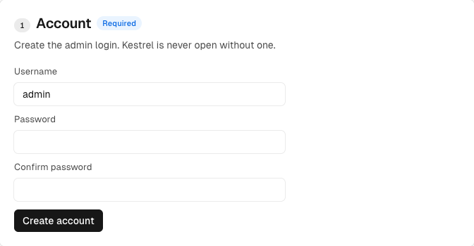
</picture>

### 2. Primary Language (required)

Choose the language your household watches in: English, German or French. Kestrel looks for Releases with that audio, falling back to a Title's original language when you allow it. The release-date country decides when a Title counts as released. It follows the language until you edit it.

You can change both later in Settings. Changing the language re-scores the files you already have.

### 3. Download client (required)

Connect SABnzbd:

| Field               | What to enter                                                                                                                            |
| ------------------- | ---------------------------------------------------------------------------------------------------------------------------------------- |
| **URL**             | `http://sabnzbd:8080`. In one compose file, a container reaches another by its service name. If SABnzbd runs elsewhere, use its address. |
| **API key**         | The key you copied from SABnzbd's Config > General.                                                                                      |
| **Movie category**  | `movies`, as you named it in SABnzbd.                                                                                                    |
| **Series category** | `tv`, as you named it in SABnzbd.                                                                                                        |

Choose **Test Connection**, then **Save**. If it says SABnzbd refused the hostname, or on Kestrel 0.14.0 and older "SABnzbd rejected the API key" when the key is right, see [SABnzbd refused the hostname](troubleshooting.md#sabnzbd-refused-the-hostname).

<picture>
  <source media="(prefers-color-scheme: dark)" srcset="images/02-setup-download-client-dark.png">
  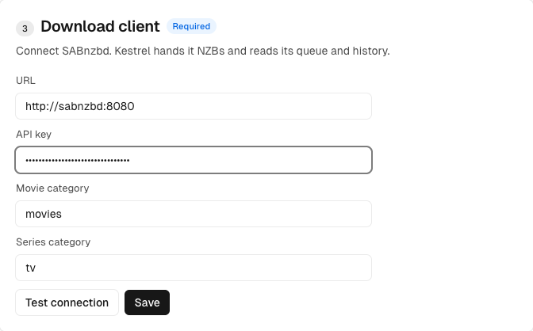
</picture>

### 4. Indexer (required)

An indexer is the site that lists what's on usenet. Kestrel searches it and fetches the NZB files. It speaks Newznab, which almost every usenet indexer does.

| Field                                          | What to enter                                                                                                              |
| ---------------------------------------------- | -------------------------------------------------------------------------------------------------------------------------- |
| **URL**                                        | Your indexer's address, such as `https://indexer.example`. Your indexer's API or "Newznab" help page shows it.             |
| **API key**                                    | From your indexer account's profile or API page.                                                                           |
| **Movie categories** and **Series categories** | Leave `2000` and `5000`, the Newznab standard for movies and TV.                                                           |
| **Seconds between searches**                   | The least Kestrel waits between two searches of this indexer. Leave `2`; raise it if your indexer is strict. `0` for none. |
| **API requests per day**                       | Your indexer's daily limit, or a little under it. Kestrel pauses searches to stay below it. Leave it empty for no limit.   |
| **Grabs per day**                              | The same for downloads, if your indexer limits them.                                                                       |

Choose **Test Connection**, then **Save**. You can add more indexers later in Settings > Downloads.

<picture>
  <source media="(prefers-color-scheme: dark)" srcset="images/03-setup-indexer-dark.png">
  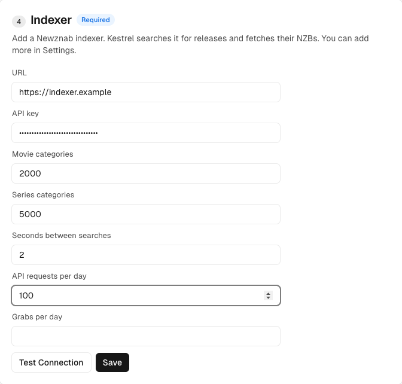
</picture>

### 5. Root folders (required)

The root folders are where Kestrel puts your Movies and your Series. They are prefilled for the layout above: `/data/media/movies` and `/data/media/tv`. Each folder must exist and be writable by Kestrel. Keep them on the same mount as your downloads, or Imports can't hardlink. Add a second folder if you want one for another audience, such as `/data/media/movies-kids`. The first is the default.

### 6. Slots (required)

This step decides how many Versions of a Title Kestrel keeps. A **Slot** is a named place in every Title that holds at most one Version, such as Standard or 4K. Each Slot has a default **Profile**, the rule for which Release to grab, for a new Movie and for a new Series.

A fresh Kestrel starts with one Slot, Standard, and no Profiles. The quickest way to set both up is a preset. Under **Start from a preset**, choose one and **Use** it. If you're not sure, choose **One copy**:

- **One copy:** Standard, HD for Movies and Series.
- **Standard + 4K:** Standard as above, plus a 4K Slot with 4K as its default. You turn it on for each Title you want in 4K.
- **Streaming + Remux archive:** Standard as above, plus a Remux Slot that defaults to 4K Remux for Movies and to no Profile for Series. You turn it on for each Title.
- **Your language + Original,** named for your Primary Language, such as **German + Original:** a Slot in your Primary Language, plus an Original Slot that wants the Title's Original Language. Every new Title gets both.

A preset replaces the Slots below it, adds each Profile it needs and enables it, in one step. It is only offered while the library holds no Version, and not while the Config File declares `slots` or `profiles`. Change anything afterwards in the editor under the presets, or skip them and set the Slots up yourself. Finishing the setup needs a default Profile for Movies and one for Series in every Slot that is on for new Titles. [Slots](slots.md) explains them in full.

### 7. Profiles (optional)

You can skip this step: the Profiles your Slots use are on already. Enable more only if you want to switch some Titles to them later, such as HD Original for anime you want in Japanese, or Any for old Titles that never had an HD Release.

Every Profile you have is listed, ticked while it is enabled. Under them the wizard lists suggestions that fit: the Original-Language twin of each default (HD gives HD Original) and Any for each HD default. Tick one to add it. **More…** and Settings > Slots & Profiles list every suggestion ([Concepts](concepts.md#profile) explains the recipes). Settings > Slots & Profiles looks like this:

<picture>
  <source media="(prefers-color-scheme: dark)" srcset="images/07-profiles-dark.png">
  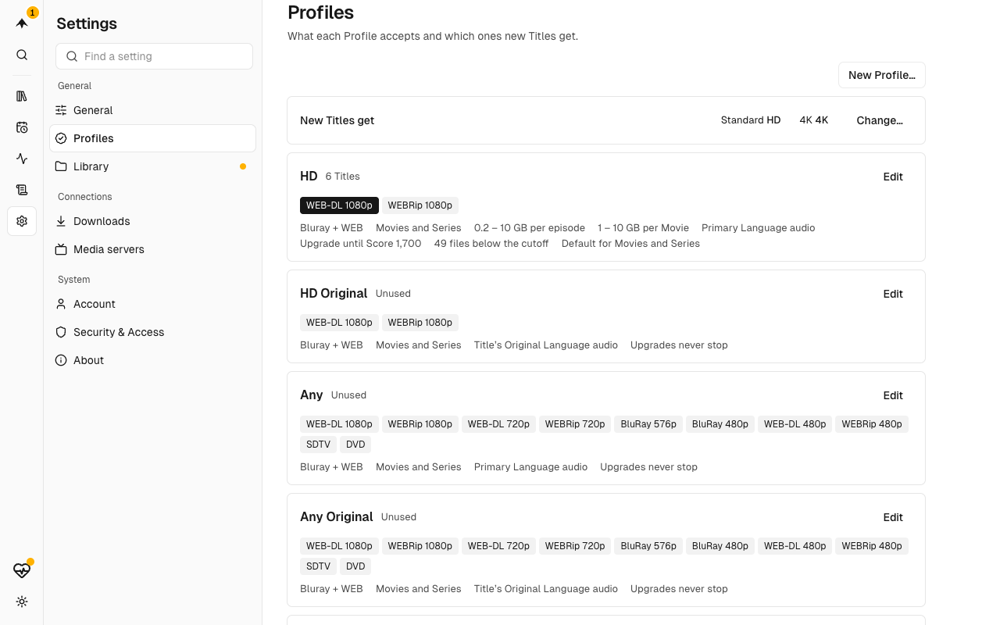
</picture>

Each Profile also has a **Cutoff** and size limits. Neither needs setting now. After setup, choose **Edit** on a Profile in Settings > Slots & Profiles (the sheet below shows them):

- **Cutoff:** **Good enough at** names a quality, and **Upgrade until Score** a Score. Once a file reaches both, Kestrel stops upgrading it. A Profile with no Cutoff never stops ([Upgrade](concepts.md#upgrade)).
- **Size limits:** **Size per episode** and **Size per Movie** give the smallest and the largest a Release may be, in GB. Leave a side empty for no limit there.

<picture>
  <source media="(prefers-color-scheme: dark)" srcset="images/13-profile-sheet-dark.png">
  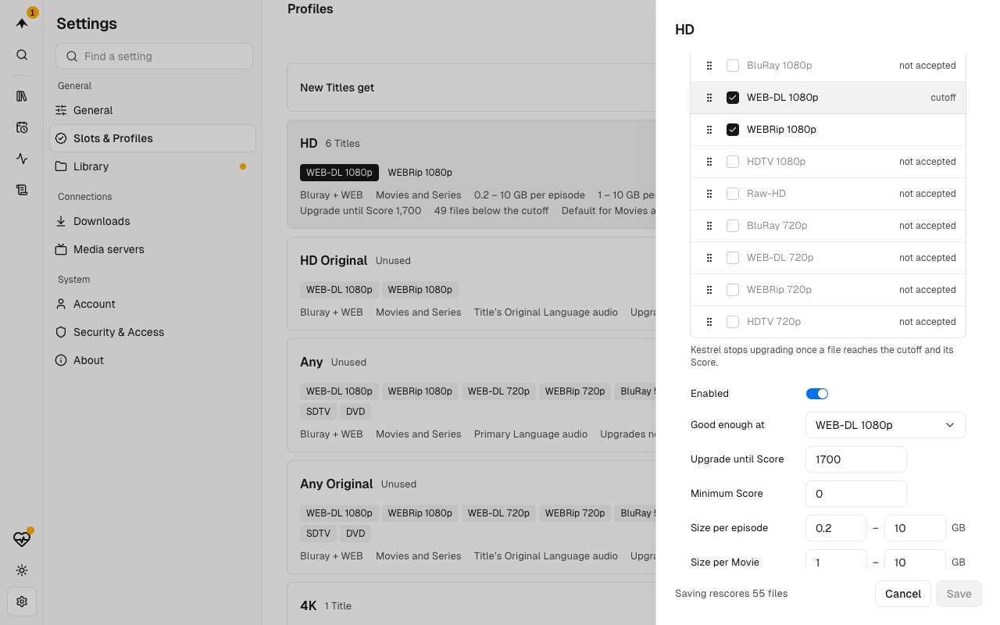
</picture>

### 8. Adopt existing library (optional)

If you already have files in those folders, Kestrel can scan them and take them in, so it doesn't download them again. Skip this for now if the library is empty. [Moving from Radarr and Sonarr](moving-from-radarr-and-sonarr.md) covers it in detail.

### 9. Summary (required)

The last step lists what is set up. Choose **Finish Setup**, and you land on the Overview. If a required step was missed, Finish names it instead. The links in the step, to the **Overview**, to **Health** and to **Slots & Profiles**, finish setup first and then open that place. Media servers are not a step: Kestrel works without Jellyfin or Plex, and you connect them later in Settings > Media servers.

Now look at the **Health** button near the bottom of the rail. Green means the download client, the indexer and the disks are fine. If it is amber or red, open it to see what is wrong.

## Add your first Title

Choose **+** at the top of the Library's side panel (on a phone, in the top bar), or press <kbd>⌘</kbd> <kbd>K</kbd> (<kbd>Ctrl</kbd> <kbd>K</kbd> on Windows and Linux; the magnifier in the rail, or the Search tab on a phone, opens the same menu), and type a name. The menu searches your Library, its commands and TMDB together; **Add Title…** searches TMDB alone. Each result's second line tells two of one name apart: Movie or Series, the network or studio, the country, the seasons or the runtime, and its TMDB score with the votes behind it. Titles you already have say "In Library" and open instead.

<picture>
  <source media="(prefers-color-scheme: dark)" srcset="images/05-add-title-dark.png">
  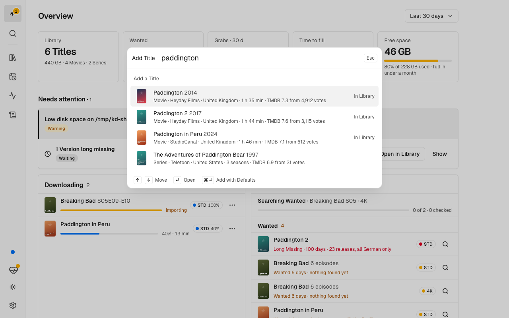
</picture>

Choose a result (<kbd>↵</kbd>) and its page opens inside the menu, with its poster, facts and overview over the choices. They start from your defaults, and a choice you change says **Changed**. Each choice opens its own list: choose one (<kbd>↵</kbd>) to pick it and return, and <kbd>Esc</kbd> goes back one step (at the first step it closes the menu).

- **One row per Slot:** such as Standard and 4K. A Slot's list holds **Off** (no file in that Slot) and each Profile; each switched-on Slot gets its own file, under the Profile you pick. With a single Slot, there is nothing to switch off.
- **Monitor** (Series only): which episodes to want: all of them, only future ones, the first or latest season, a pick of seasons, or none.
- **Root Folder:** where the Title is filed, the first one unless you pick another.

Choose **Add Movie** or **Add Series** (or press <kbd>⌘</kbd> <kbd>↵</kbd>); its second line sums up what will be added. The menu closes and a Toast confirms, with a link to the Title. <kbd>⌘</kbd> <kbd>↵</kbd> on a result in the list adds it with the defaults without opening its page. On a phone the page slides in with a **Back** button, and **Add** stays at the bottom.

## What Kestrel does next

You don't need to do anything else. Kestrel does this on its own:

1. **Searches.** A new Title is searched straight away. After that, Kestrel searches everything that is [Wanted](concepts.md#wanted) every five minutes.
2. **Scores and grabs.** From the Releases the indexer lists, Kestrel picks the best one that fits the Version's Profile and sends it to SABnzbd.
3. **Follows the download.** Activity shows each Grab from Searching to Downloading, with progress. A download that makes no progress is flagged as stuck ([Troubleshooting](troubleshooting.md#a-download-is-stuck)).
4. **Imports.** When SABnzbd is done, Kestrel hardlinks the file into the Title's folder under your root folder and names it by its fixed scheme, such as `Paddington (2014) {tmdb-116149}/Paddington (2014) {tmdb-116149} - [Standard] …`.
5. **Tells your media server.** If you have connected Jellyfin or Plex in Settings > Media servers, Kestrel asks it to refresh.
6. **Keeps upgrading.** If a better Release appears later, Kestrel replaces the file, until it reaches the Cutoff of the Version's Profile, if you set one.

<picture>
  <source media="(prefers-color-scheme: dark)" srcset="images/04-series-dark.png">
  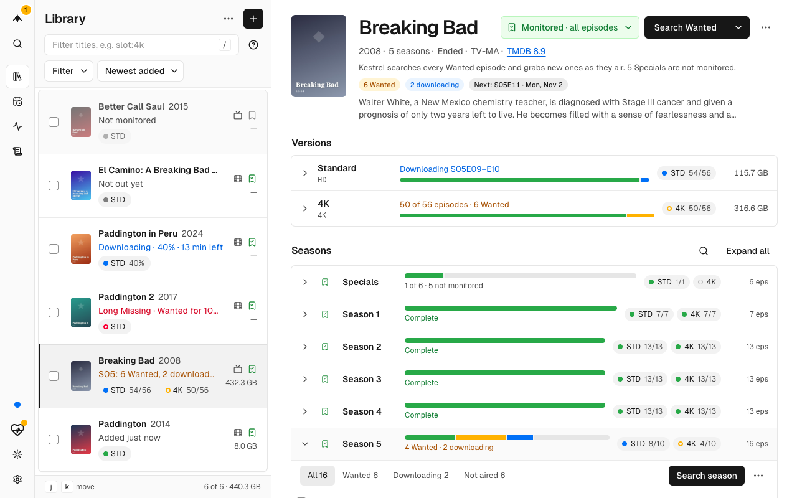
</picture>

The Title page shows each Version as a card: its Slot and Profile, what it holds or is waiting for, and its next step, such as **Search Now** or **Search for Upgrade**. A Series' card adds a bar of its episodes, and below the cards comes the Seasons table, with a column per Version. Its rows start closed, and a click opens one. **All**, **Wanted**, **Downloading** and **Not aired** above the table filter the seasons and their episodes. To open seasons by themselves, turn on Open the newest season in Settings > General > Display.

To search by hand, use **Search Wanted** at the top of the page, or **Search All Wanted in Season 1** in a season's **...** menu. **Manual Search…**, in the menu beside the button and in the **...** menus, lists every Release, so you can choose one yourself.

**Upcoming** is the timeline of what is airing or being released, from the last two weeks to the next two months, and where each one stands. Narrow it with the filter field (press `/`) or the Filter button: free text matches the Title and the episode's name, `kind:movie` or `kind:series` picks a kind, `is:wanted` and `is:imported` pick what is still to find or already in the Library, and a minus excludes (`-is:imported`). `?q=` in the address holds the filter, and a new session starts from the defaults in Settings > General > Display. On every screen with a filter field, the × in the field, Escape in it, or **Clear All** at the top of the Filter menu empties the whole filter.

<picture>
  <source media="(prefers-color-scheme: dark)" srcset="images/06-upcoming-dark.png">
  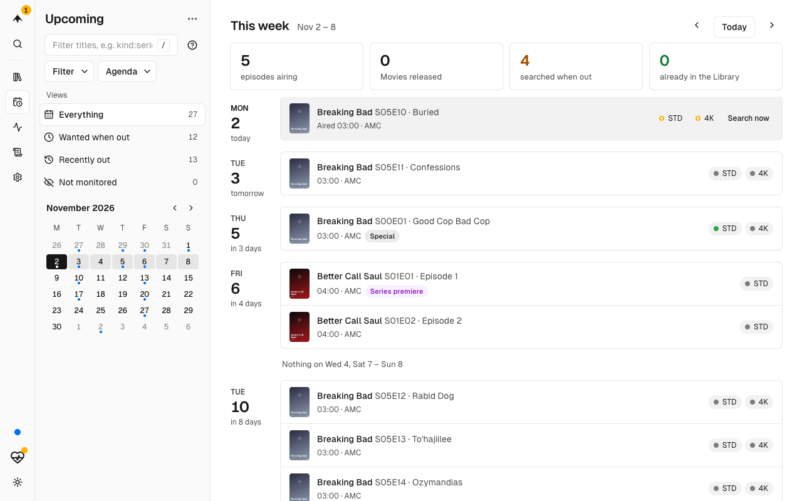
</picture>

## A tour of the screens

Kestrel has a few screens, each with its own address. On a desktop they are the buttons of the **rail** down the left; on a phone the tab bar holds the Overview, Library, Upcoming and Activity, and **More** holds the rest.

- **Rail:** the Kestrel mark opens the Overview (a badge counts what needs attention). Under it are **Search or Add** (`Ctrl K` or `Cmd K`), Library, Upcoming, Activity and Log. At the bottom are the **Health** button, the theme switcher and, last, **Settings**.
- **Side panel:** most screens have a column beside the rail with the screen's name, a filter field, the **Filter** menu and **Views**, a short list of ready-made pages of that screen. [Concepts](concepts.md#views-and-the-filter-menu) explains how Views and Filter differ. On a phone the same controls sit in the header, and the Views join the Filter menu.
- **Overview:** what needs you now, and what Kestrel is doing.
- **Library:** every Title, with its Versions and files.
- **Upcoming:** what airs or is released soon.
- **Activity:** every Grab from Searching to Done.
- **Log:** everything Kestrel did, and why.
- **Health:** whether the download client, indexers and disks are fine, and what runs in the background.
- **Settings:** the sections of Kestrel, in groups: General (language and display, Slots & Profiles, Library), Connections (Downloads, Media servers) and System (Account, Security & Access, About). "Find a setting" at the top of the list finds one by name. [Customizing](customizing.md) says what you can change there.

<picture>
  <source media="(prefers-color-scheme: dark)" srcset="images/08-overview-dark.png">
  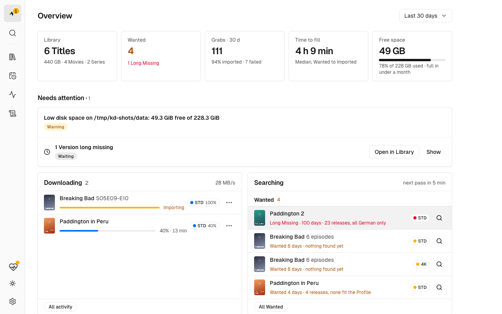
</picture>

## The Overview and Activity

The **Overview** is the home screen. From the top:

- **Figures** sum up the library. The menu at the top right picks the range, 30 days unless you change it.
- **Happening now** starts with **Needs attention**, what wants a decision: one compact row per item with its poster and buttons, plus an Adoption plan waiting for review and Originals on offer. Under it, **Downloading** and **Searching** sit side by side. Searching lists what is still Wanted, and its top line counts the Long Missing Versions and opens them in the Library.
- **Recently added**, **Recent requests** and **Coming this week** are three short lists, each with a link to its screen.
- **The dashboard** shows the range you picked: Grabs per day, Indexers, the download client, Quality, Storage, Release groups and Requests.

Press `j` and `k` to move through the rows. A phone shows a shorter dashboard.

The **Health** button (a heart-pulse icon with a status dot, near the bottom of the rail and on a phone in the top bar next to the **+** that adds a Title) is green when all checks are OK, amber with Warnings and red with Blocking issues; hover it for "Health · 1 Blocking, 2 Warnings". It reads "Offline" when Kestrel can't be reached, and a Blocking issue also puts a banner across every screen. A disk that is running low shows as a Health check and a row in Needs attention. When something runs, an indicator above the button says what and opens Health's Background jobs. **Log Out** and **Log Out Everywhere** are in Settings > Account (and under **More** on a phone), and **About**, with the version and the keyboard shortcuts, is the last page of Settings.

**Activity** (`/activity`) shows every Grab from Searching to Done, in stage order: Searching, Queued, Downloading, Post-processing, Importing, Stalled, Done and Failed. The side panel's Views (Everything, In progress, Imported, Failed) narrow it to some of them, and a Grab opens to show its steps (see below). While a search pass runs, the Searching stage shows it like a download: what is being searched now, a progress bar with how many Wanted Versions are done and the time left, and how many releases have been checked and Grabs made so far. Between passes it says what waits, when the next pass starts and how the last one went. Narrow it further with the filter field or the Filter button (`stage:` takes the stage names).

Choose a row in the History to open it. The steps run oldest first: when the Grab was made and by what, when it downloaded and how fast, and how it ended, as an Import with the files it wrote or a failure with its reason. A failed Grab adds a **Now** note saying whether its Release is blocklisted and whether the Title is still Wanted, with **Search … Now** and **Manual Search…** buttons.

<picture>
  <source media="(prefers-color-scheme: dark)" srcset="images/10-grab-steps-dark.png">
  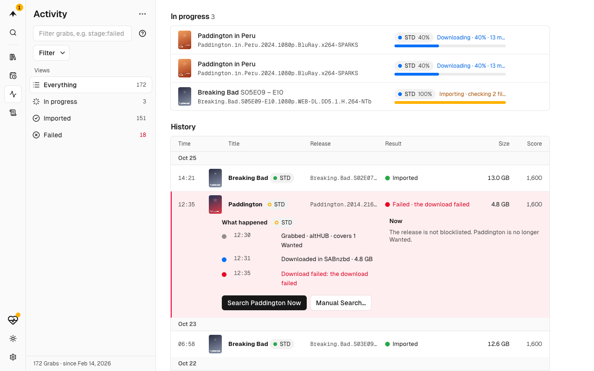
</picture>

The **Manual search** of a Title lists every Release the indexers offered for one Version, the ones that fit its Profile first and the rejected ones, with why, under a **Best fit** card. **Grab** sends one to the download client.

<picture>
  <source media="(prefers-color-scheme: dark)" srcset="images/09-manual-search-dark.png">
  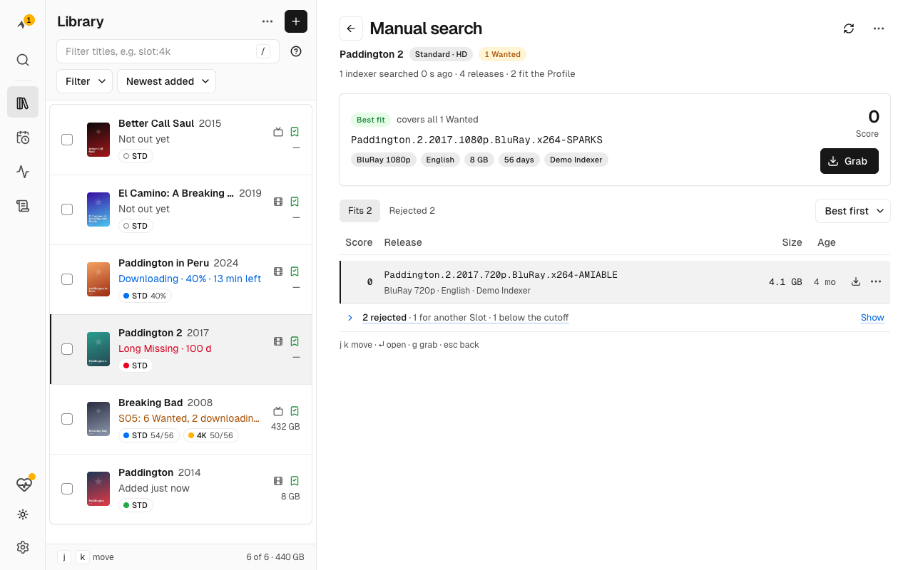
</picture>

**Health** (`/health`) is a screen of its own, opened by the Health button; it is not in the side bar's list of screens. It opens with the verdict in words, then has three sections, chosen in the side panel and each with its own address:

- **Running now** (`/health/running`) lists what Kestrel is running at this moment.
- **Checks** (`/health/checks`) shows every check in groups: the download client, each indexer, each disk and the rest, failing ones first. It counts problems, warnings and OK checks.
- **Background jobs** (`/health/jobs`) shows what Kestrel is running now and when each periodic job last ran and runs next. The indicator above the Health button that says what is running opens it. Its Search job shows the same progress as Activity's Searching stage and has a **Search All Wanted** button, the same as the command menu's, which is off while a search pass is running or nothing is Wanted. A search you start from there, from the command menu or with **Run Now** shows one Toast that follows the pass live and ends with a summary; passes Kestrel starts on its own show none.

The old `/activity/health`, `/activity/jobs` and `/activity/running` addresses still work and open the same places.

<picture>
  <source media="(prefers-color-scheme: dark)" srcset="images/12-health-dark.png">
  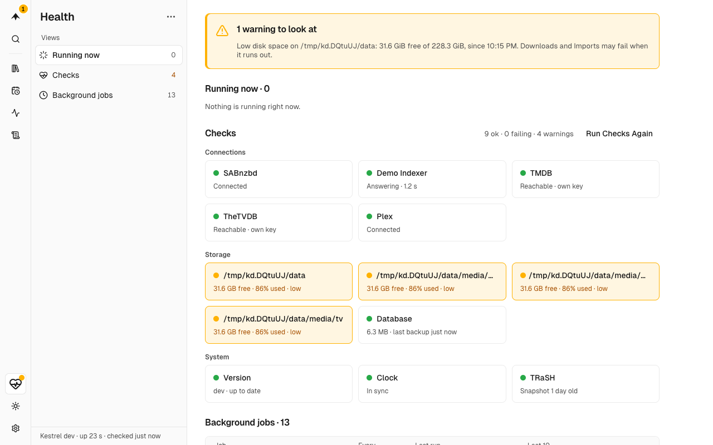
</picture>

## Where to go next

- Make Kestrel fit your household: [Customizing](customizing.md) lists what you can change and where.
- Connect Jellyfin or Plex in Settings > Media servers, so new files show up at once.
- Let the people you share Plex with ask for Titles themselves: [Requesters](configuration.md#requesters-plex-sign-in).
- Coming from Radarr and Sonarr? [Moving from Radarr and Sonarr](moving-from-radarr-and-sonarr.md).
- Want the same setup every time? Declare it in a [Config File](configuration.md#the-config-file).
- Something not working? [Troubleshooting](troubleshooting.md).
